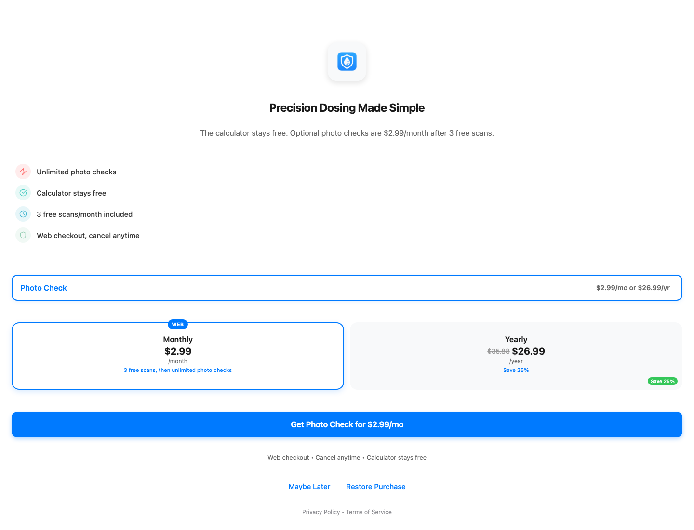
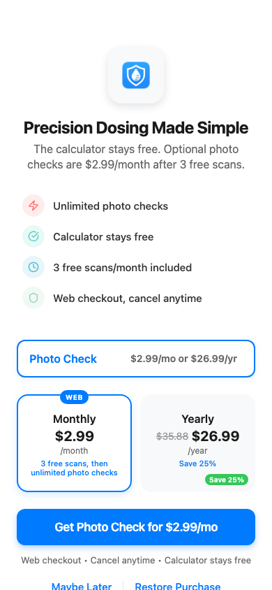

# Photo Scan readiness review — 2026-11-15

Captured the deployed https://safe-dose.vercel.app/pricing with a separate Playwright headless Chromium process (1440×1100 desktop; 390×844 mobile). No existing browser or screen was controlled. Screenshots show production, whose paywall UI is unchanged by this server-only patch.

## Checkout observations

POST /api/create-checkout-session with each offerKey (`photo_check_monthly`, `photo_check_annual`), production successUrl and cancelUrl returned HTTP 200 with a `cs_live_` session ID. No payment was completed. Source resolves `safedose_photo_check_monthly` / `safedose_photo_check_annual` unless an explicit price environment variable overrides it. The historical 503 cannot be reproduced; the matching source error is thrown when neither the price override nor an active lookup-key price exists in live mode.

Exact Stripe account and resulting price IDs remain unverified: the Stripe connector returned Unknown tool and no local live credential was available. Session creation alone does not prove account ownership or successful fulfillment.

The patch removes secret-prefix/request-body diagnostics and full Stripe error object logging, and lets Stripe choose available payment methods instead of hardcoding cards.

## Remaining payment readiness blockers

- Checkout does not bind a verified Firebase user or persist a Stripe customer mapping.
- `api/stripe-webhook.js` verifies signatures but only logs lifecycle events (database updates are TODOs).
- `api/validate-session.js` checks payment status without ownership; `app/success.tsx` grants a legacy `plus` plan from the client and says 150 scans/month.
- Subscription cancellation/failed renewal is not reconciled into Firestore. These prevent claiming autonomous paid entitlement delivery even though session creation works.

## PR #425 review

Reviewed head 95779f3; left open and unmerged. The intended existing-Firestore-profile route is implemented and all 14 new Google-auth/onboarding unit tests pass. CI and Vercel passed. Accuracy workflow failed: offline vision eval cannot resolve `.eval-cache/lib/scan/request` (run 43766540852); vision typecheck and 65 vision tests passed.

Before merge, address or explicitly resolve:

1. `resolveLaunchRoute` falls back to device-global onboarding/profile state even when a different signed-in UID has no remote profile. Logout deliberately preserves that cache. Reproduction: user A completes onboarding, logs out, user B signs in with no remote profile; B is routed home using A's state instead of Age. Tests cover only empty storage for new accounts. Scope local cache to UID and test account switching.
2. Redirect completion only restores auth. Welcome has no auth-change routing effect, so a popup-blocked redirect returning to `/onboarding` does not execute the popup's `routeAfterGoogleSignIn`; `app/index.tsx` only runs on `/`. Exercise/fix redirect return routing before claiming returning users always skip onboarding.
3. Actual Google popup/redirect and Firestore integration were not exercised with a real account. Unit tests mock those services.

Baseline `./verify check`: 10 passed, 1 failed (screenshot baseline comparison); all seven required checks and named flow checks passed. Its named flows and screenshot renderer are fixtures/source checks, not a real browser/auth integration test. Screenshot baseline failure was not hidden by regenerating baselines.
